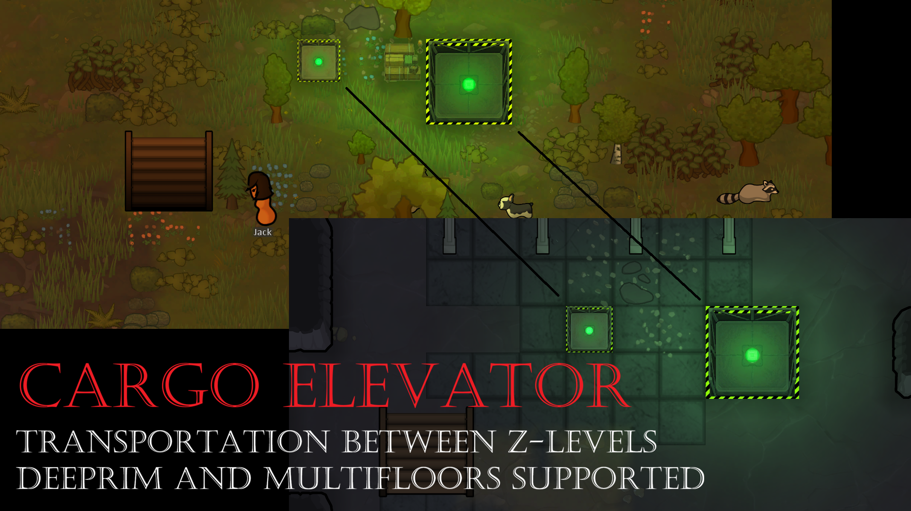

# Cargo Elevator

A RimWorld 1.6 mod that moves items, colonists and animals between the levels of one location: the surface, DeepRim layers and MultiFloors levels.

## Why this mod

Cargo Elevator brings conveyor-style automation to multi-level colonies. Items put into an elevator on one level come out at its partner on another level, into storage there. No pawn has to carry them across.

The level mods already offer some transfer, but neither covers automation well:
- **DeepRim** has a simple automatic transfer from one floor to another. It isn't flexible, and it drops the items on random cells around the shaft.
- **MultiFloors** has a more complex system, but it doesn't work together with automation such as conveyor belts.

Cargo Elevator is a simple elevator, not a smart controller. It passes things between levels and leaves the logistics to you: storage filters, priorities, conveyors and explicit transport orders.

## Features

- **Two elevator sizes**, linked in pairs, one on each level:
  - **Cargo elevator** (1x1): 1 intake cell, delivers to the 8 cells around it, sends one stack per second, buffer of up to 4 stacks.
  - **Large cargo elevator** (2x2): 4 intake cells, delivers to the 12 cells around it, four times as fast, buffer of up to 8 stacks.
- **Works like storage on the sending side.** Colonists haul into an elevator like into a shelf, using its storage filter and priority. Conveyor belts and other mods can feed it too.
- **Delivers into storage on the receiving side.** Items go into stockpiles, shelves or hoppers next to the partner elevator, highest priority first. If none accepts them, they are put on free floor next to it (optional). Partial deliveries are fine; whatever doesn't fit waits in the buffer.
- **Transport loader:** a small building next to an elevator. It opens the familiar portal window, where you choose items, people and animals to send. Items ride the elevator; people and animals step out at the other end.
- **Per-elevator options:** buffer size, first in first out, merge stacks, drop on floor, allow insert (whether colonists may haul into it), rename.
- **Status at a glance:**
  - a green lamp while it works and a red lamp while it's blocked, bright even at night;
  - a status line that says why transfer is paused (storage full, no storage, not connected, no power, ...);
  - a soft green or red glow that lights dark underground rooms a little.
- **Power at both ends:** more while moving items, little while idle.
- **Mod settings:** transfer speed, buffer size and power for each size, the lights, and verbose logging for bug reports.

## Requirements and installation

**Required:** [Harmony](https://github.com/pardeike/HarmonyRimWorld/releases/latest) (`brrainz.harmony`).

**Optional, in any combination:** DeepRim, MultiFloors, Vanilla Furniture Expanded - Factory (conveyors), Better Architect Menu.

**Install:**
1. Download this repository (Code > Download ZIP) or a release.
2. Copy the `CargoElevator` folder (the one that contains `About` and `Defs`) into your RimWorld `Mods` folder, for example `RimWorld/Mods/CargoElevator`. The compiled DLL is included in `CargoElevator/1.6/Assemblies`.
3. Start the game, open **Mods**, enable Harmony and Cargo Elevator, and restart when asked.

**Load order:** Harmony first. Cargo Elevator loads after Harmony, DeepRim and MultiFloors; the game's **Auto-sort** button sets this for you. The order relative to Better Architect Menu doesn't matter.

**Saves:** you can add the mod to an existing save. To remove it, deconstruct all elevators and loaders first and empty them; items in their buffers are lost with the mod.

## How to use

### 1. Research and find the buildings
Research **cargo elevators** (Industrial, after Electricity). The buildings appear in their own **Cargo elevator** tab in the architect menu. With Better Architect Menu they're under **Structure > Elevation** instead, next to MultiFloors' elevators if it's installed.

### 2. Build a pair
1. Build an elevator on one level.
2. On another level, build an elevator of the same size **at the same position measured from the centre of the map**. On maps of the same size, this is simply the same cell.
3. They link by themselves. If several unconnected elevators match (on different levels), use **Connect to...** to pick one. The link can't be changed later; to re-link, deconstruct an elevator and build it again.

While you place an elevator, the cells that line up with an unconnected elevator on another level are highlighted. The text under the cursor shows which level it will connect to.

Elevators need heavy ground: not marsh, mud, soft sand, shallow water or bridges. An elevator can be built before the other level exists; it stays "disconnected" until a partner appears.

**Power both ends.** Transfer pauses whenever either end has no power.

### 3. Send items automatically
- **Set the storage filter** of the sending elevator (the Storage tab). **Nothing is allowed by default**, so colonists won't haul anything into a new elevator.
- Raise its storage priority if colonists should prefer it over other storage.
- Or feed it with conveyor belts (VFE Factory). Turn off **Allow insert** if only belts or other mods should feed it, not colonists.
- Items that enter the elevator disappear into its buffer and are sent one stack at a time.

At the other end, put storage next to the partner elevator: a stockpile, a shelf or a hopper. Only the cells touching the partner are used. A large stockpile counts only where it touches the elevator.

When no storage next to the partner accepts an item:
- **Drop on floor** on (default): it's put on a free floor cell next to the partner.
- **Drop on floor** off: it waits in the buffer.

When the storage is full, items wait in the buffer and transfer resumes as soon as there's room.

Both ends of a pair can send; each end's own filter decides what it sends, so ore up and food down works on one pair. Don't let an end's filter allow what it receives, or the items get hauled back in and bounce.

### 4. Send a chosen list, or colonists and animals
1. Select an elevator and use its transport loader build button, or build a loader from the architect menu right next to an elevator. It links to that elevator by itself (use **Connect to...** if several elevators touch it).
2. Select the loader and use **Open transport menu**. Choose items, people and animals as in any portal window.
3. Colonists haul the chosen items into the loader. The elevator takes them from the loader into its buffer and sends them along with its normal traffic. People and animals walk into the loader and arrive next to the partner elevator.

The loader's orange lamp is steady while an order is in progress, and blinks while items wait in it with no order. **Transfer items to elevator** can be turned off to hold items in the loader. When several loaders touch one elevator, their **priority** decides which one it empties first. The loader needs no power, but the elevator pair must be connected and powered for anything to go through. Loaders can be uninstalled and reinstalled; a reinstalled loader links again by itself.

### 5. Elevator controls

| Control | What it does |
| --- | --- |
| Fewer slots / More slots | Buffer size; one slot holds one full stack. |
| First in, first out | On: items are sent strictly in order, so a stuck first item holds up the rest. Off: the first item that can be delivered is sent. |
| Merge stacks | On: arriving items join a buffered stack of the same kind. Off: each arrival takes its own slot. |
| Drop on floor near target | On: items no storage accepts are put on the floor next to the partner. Off: they wait. |
| Allow insert | Off: colonists stop hauling into it. Conveyors, other mods and the loaders still work. |
| Unload | Puts the whole buffer down nearby; colonists haul it to storage. Works while disconnected. |
| Go to partner | Jumps to the linked elevator. |
| Rename | Gives the elevator a name, shown in menus and messages. |

The Contents tab lists the buffer and lets you drop single entries.

### 6. Mod settings
Options > Mod settings > **Cargo Elevator**. Changes apply when the window is closed, also to elevators and loaders already built.
- For each elevator size: ticks between sent stacks (speed), maximum buffer slots, power while transferring and while idle.
- Lights: whether elevators and loaders light up their surroundings, whether the large elevator uses its even (centred) light, whether loaders blink.
- Verbose logging: off by default. Turn it on to write every transfer, link and state change to the log, for bug reports.
- Reset to defaults.

## Mod interaction

- **DeepRim:** elevators work between the surface and any layer, and between layers. If you set DeepRim's layer size smaller than the surface map, the smaller map sits over the centre of the larger one, cell for cell. Elevators outside the smaller map's area can't connect to it, and an elevator's position relative to the DeepRim shaft may differ between levels. To avoid both, give DeepRim layers the same size as the surface map.
  Watch out: DeepRim's shaft pulls items out of storage next to it. Keep the elevators' output storage away from the shaft unless you want that.
- **MultiFloors:** elevators work between any levels of a stack, including MultiFloors levels opened on a DeepRim layer. Level names in menus and messages follow MultiFloors' symbols, for example "B1 (MultiFloors)".
- **DeepRim and MultiFloors together:** all levels on one world tile can connect to each other, for example "70m (DeepRim), B1 (MultiFloors)".
- **Vanilla Furniture Expanded - Factory:** conveyor belts can push into an elevator, and an elevator delivers into hoppers and other storage next to it.
- **Better Architect Menu:** the buildings move into Structure > Elevation, and the separate Cargo elevator tab is removed. Load order doesn't matter.
- **Other level mods:** maps that other mods place on the same world tile should work the same way, but only DeepRim and MultiFloors are tested.

There is no compile-time reference to any of these mods; each one is optional.

## Known limitations

- Each elevator links to exactly one partner of the same size. The link is fixed once made.
- Pocket maps (for example the Anomaly undercave) are meant to pair with the map they were opened from, but this is untested.
- Using a transport loader as the way out of a pocket map is untested.
- In the transport menu, removing one colonist from an order of several may not stop that colonist from walking in. This is the vanilla portal window's behaviour.

## Generative AI use

This mod was designed and built with Claude Opus 5.5 (Anthropic) as the main engineer, working as a planner and as implementing agents for each step. Claude did most of the work:
- **Reverse-engineering:** worked out from the decompiled RimWorld 1.6 code and the DeepRim, MultiFloors and VFE code:
  - how maps on one world tile and pocket maps relate, and how DeepRim and MultiFloors create and name their levels;
  - how the hauling system picks storage cells, and why it needed a Harmony patch;
  - how vanilla portals and transporters load items, pawns and animals;
  - how the glow grid computes light, to centre the large elevator's light.
- **Planning:** drew up the overall plan and a specification for each implementation step, and kept them up to date with the test results.
- **Implementation:** wrote the C# code, the XML definitions, the Harmony patches, the Better Architect Menu patch and the mod settings.
- **Testing:** built every step and simulated the lighting; in-game testing was done by the project owner.
- **Documentation:** wrote this README, the mod description, and the project's plan and step notes.
- **Version control:** managed the git commits.

**Art:** the base building images and the icons were created with Nano Banana 2 (Google), followed by heavy editing by hand.

The project owner set the goals and constraints, made the design decisions, supplied the game and mod files, and tested every change in game.
